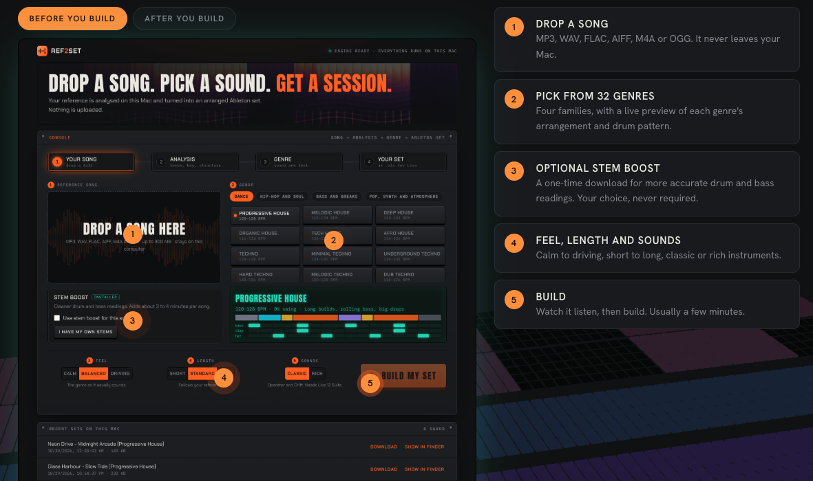
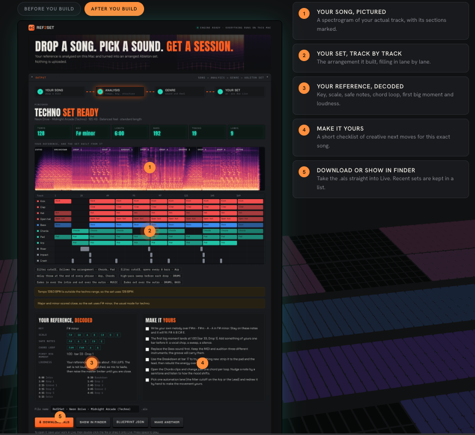

# Ref2Set

Start with a track you love. Ref2Set reads its tempo, key, and structure, then builds an original, editable Ableton Live set (.als) you can shape into your own. The free Mac app analyzes the song locally and deletes the audio when each job finishes.

- [Open Ref2Set](https://analyze.shabbamusic.com)
- [Download the latest release](https://github.com/Shabbamusic/ref2set/releases/latest)
- [SHABBA Music on YouTube](https://www.youtube.com/@ShabbaSounds)

## App walkthrough

These are the Before and After panels from the Ref2Set website. They illustrate the app workflow; they are not a live browser version of the Mac app.

### Before the build

### After the build

## Your first build

Download and open the Mac app, drop in a reference track, choose a genre and feel, then build. Open the resulting set in Ableton Live 12 Suite and change a part until it feels like yours.

## Requirements

- Mac with Apple silicon (M1 or newer; Intel Macs are not supported)
- macOS 11 Big Sur or newer
- Ableton Live 12 Suite
- About 350 MB installed space; the first public download is 116 MB

## Install and run

1. Download Ref2Set-1.0.0.dmg from [Releases](https://github.com/Shabbamusic/ref2set/releases/latest).
2. Open the DMG and drag Ref2Set into Applications.
3. Ref2Set is not notarized by Apple yet. On first launch, macOS may block it. Click Done, then open System Settings > Privacy & Security and click Open Anyway beside Ref2Set. You only need to do this once. On macOS 15 and newer, right-click > Open no longer skips this step. Terminal alternative: xattr -dr com.apple.quarantine /Applications/Ref2Set.app.
4. The first launch runs a one-time setup with a progress bar. Then drop a song into the console. Analysis takes about half the song's length.

## Verify the download

The release page lists the DMG's SHA-256 digest. For version 1.0.0, run shasum -a 256 ~/Downloads/Ref2Set-1.0.0.dmg and compare the result with the release page.

## Files and removal

Sets are saved in ~/Library/Application Support/Ref2Set/sets. Quit with Command-Q, Dock > Quit, or the console's Quit button. Closing the console tab also stops it after a few seconds. To remove Ref2Set, delete the app and its application-support folder.

## Help and related tools

For product information, visit [analyze.shabbamusic.com](https://analyze.shabbamusic.com). Report reproducible problems in [GitHub Issues](https://github.com/Shabbamusic/ref2set/issues), including your macOS and Ableton versions and the steps that led to the problem.

Explore [SHABBA Plugins](https://github.com/Shabbamusic/shabba-plugins), [ARCLINE](https://github.com/Shabbamusic/arcline), [Visualizer](https://github.com/Shabbamusic/shabba-visualizer), [Audio](https://audio.shabbamusic.com), and the [SHABBA hub](https://shabbamusic.com).

## Source and license

This repository currently provides the Mac app through release downloads; it does not publish the app source or state a software license. The redistribution terms for the app and any third-party components need to be documented before the project is described as open source.

© 2026 SHABBA Music
